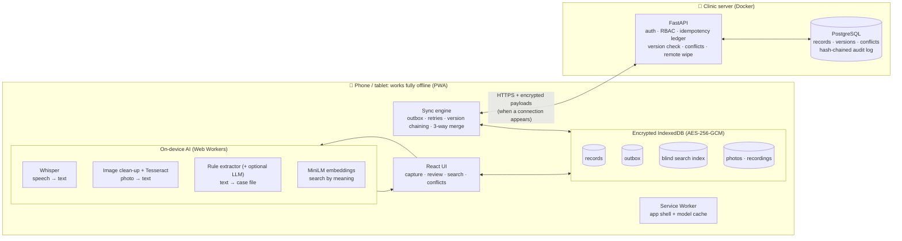

# HCare: offline-first AI clinical assistant

**For rural health workers with no reliable internet.** Speak a clinical note or photograph a lab report. The AI on the phone turns it into a structured case file, a clinician verifies it, and it syncs safely to the clinic server whenever a connection appears. It works in **airplane mode**: no cloud AI, no patient data leaving the device unencrypted.

> **Judges, start here:** [Demo script](docs/DEMO.md) · [Evaluation results](docs/EVALUATION.md) · [Sync engine](docs/SYNC_ENGINE.md) (the core deliverable) · [Security](docs/SECURITY.md) · [AI pipeline](docs/AI_PIPELINE.md) · [Setup on a new laptop](docs/SETUP.md)

## What it does

| | |
|---|---|
| 🎙 **Voice notes → text** | Whisper runs **in the browser** (Web Worker, WebGPU or CPU). Supports English, Hindi and 9 other Indian languages, with optional translation to English. The transcript is always editable |
| 📄 **Document photos → text** | The photo is cleaned up on the phone (straightened, shadows removed, denoised), then read by Tesseract OCR. Uncertain words are highlighted for checking |
| 🧾 **Structured case file** | Multilingual extraction (English, Hinglish, Devanagari) of complaint, symptoms, vitals, medicines, allergies, labs and follow-up. **Every field shows its source and confidence.** Nothing is final until a clinician verifies it |
| 🔎 **Offline search** | Searches by name, ID, symptom, medicine or date in any language ("bukhar" finds "fever"; "dolo" finds paracetamol). Optional search by meaning. About 10 ms on thousands of records |
| 🩺 **Patient history** | A summary of conditions, allergies, medicines and trends (BP, Hb…), with **every line linked to its source visit** and safety alerts (e.g. "prescribed a drug the patient is allergic to") |
| 🔄 **Sync engine** | Offline outbox, unique op IDs, version checks, retry-safe requests, conflict detection, and **field-by-field three-way merge** recorded in a tamper-evident audit log |
| 🔒 **Security** | AES-256-GCM encryption on the device, encrypted sync payloads, lock screen, remote wipe of lost phones, role-based access |
| 👥 **Roles** | Health workers capture visits. Doctors get a review queue. Admins manage staff, devices and the audit log |

## Architecture



**Lifecycle of a visit:** voice or photo → text on the device → the clinician corrects it → structured into a draft case file with sources → verified by a clinician → saved encrypted with an outbox entry → synced once online.
- The server applies the change, ignores duplicates, or stores a conflict.
- A conflict is merged field by field and audited.

## Why it's different

- **Really offline, really on-device.** All AI runs in the browser. The app loads, signs in, captures, structures, searches and summarizes in airplane mode. Each model downloads once.
- **AI never decides alone.**
  - Extraction only takes facts stated in the notes.
  - Anything from the optional language model must be found in the source text, or it's dropped and reported. An invented diagnosis is a test case, and it's rejected.
  - Every field links to its source recording or photo.
  - Low-confidence fields must be confirmed before **Verify** is enabled.
- **Sync that can be proven.**
  - Each guarantee in the problem statement (no loss, no duplicates, no silent overwrite, safe retries, detected conflicts) is tested against the real server with injected network faults. See [SYNC_ENGINE.md](docs/SYNC_ENGINE.md).
  - Merges never drop an allergy, and a verified case file loses its verification if a merge changes it.
- **Built for cheap phones.**
  - Quantized models load on first use, and heavy work runs in workers.
  - The rule extractor works on any phone.
  - The 1.5B language model is offered only where the hardware can run it. On CPU-only phones it would run out of memory, as measured in testing.

## Results

Measured on the real app in a browser, on a CPU-only laptop. Methods and caveats are in [docs/EVALUATION.md](docs/EVALUATION.md).

| | |
|---|---|
| Speech to text (Whisper Base, on-device) | **3.6 % WER** · 2.4 s per clip |
| OCR on phone-style photos (tilt, shadow, blur) | **2.1 % CER** · the worst page was also the one flagged least certain |
| Case-file extraction (18 notes, including real speech-recognition output) | **100 % precision / 100 % recall** (74 fields) |
| Sync fault scenarios (duplicates, lost acks, cut-off batches, two-device conflicts) | **All pass**; no record lost, duplicated or silently overwritten |
| Offline search | **1–15 ms** per query on thousands of records, including encrypted ones |
| Automated tests | **131** frontend · **44** backend · **11** browser (+ evaluation run, + 1 GPU-only) |

## Quick start

```bash
git clone https://github.com/Yash-041/HCare.git && cd HCare
docker compose up -d --build                     # API on :8000 + PostgreSQL
cd frontend && npm install && npm run build && npx vite preview   # app on http://localhost:4173
```

Sign in as **`asha` / `asha1234`** (health worker), **`doctor` / `doctor123`**, or **`admin` / `admin123`**.

For full setup (Windows, macOS or Linux), the offline demo, phone access and troubleshooting, see **[docs/SETUP.md](docs/SETUP.md)**.

## Tech stack

| Layer | Technology |
|---|---|
| App (PWA) | React 19, TypeScript, Vite, vite-plugin-pwa (Workbox), Dexie (IndexedDB) |
| On-device AI | transformers.js (Whisper, MiniLM, optional Qwen2.5-1.5B on WebGPU), Tesseract.js, custom image preprocessing |
| Crypto | WebCrypto (PBKDF2, AES-GCM), @noble/ciphers and @noble/hashes (synchronous AES-GCM inside IndexedDB transactions, HMAC blind index) |
| Server | FastAPI, SQLAlchemy, PostgreSQL 16, PyJWT, cryptography |
| Tests | pytest, Vitest, Playwright (including real-model and two-device tests) |

## Tests

```bash
cd backend && pytest                    # sync server, security, staff management (SQLite; Postgres via TEST_DATABASE_URL)
cd frontend && npm test                 # sync engine vs the real API with network faults, encryption, AI extraction, search, merge
cd frontend && npm run test:e2e         # real browser: offline reload and sign-in, two-device conflict, search, history, roles
HCARE_E2E_AI=1 npm run test:e2e         # plus real Whisper, OCR and embedding models
HCARE_EVAL=1 npx playwright test e2e/evaluation.pw.ts   # regenerate docs/eval/results.json
```

## Repository

```
backend/    FastAPI sync server (app/), pytest suite (tests/), Dockerfile
frontend/   PWA: src/lib (sync, crypto, search, history, merge), src/ai (workers, extraction), src/pages
            tests/ (Vitest), e2e/ (Playwright, evaluation, demo fixtures)
docs/       SYNC_ENGINE, SECURITY, AI_PIPELINE, EVALUATION, DEMO, SETUP, data model
```
